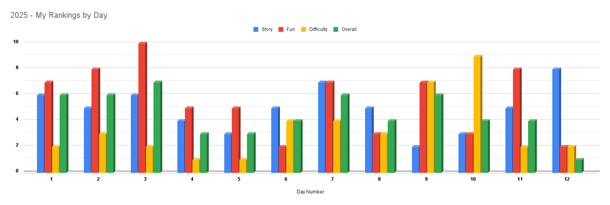

# Overall Results

## Timings

I created a utility to run all of the days a given number of times and average the times to get a true average run time.
I made it so I can run just the parsing of the input data, part 1, part 2, or all of them combined so I can see a true
breakdown of how long each part of my total Advent of Code takes.

For the below, I ran each part individually and then everything together.

|              | Exec. Time (ms) - Python 3.14 | Exec. Time (ms) - PyPy 3.11 |
|--------------|------------------------------:|----------------------------:|
| **Get Data** |                      TODO |                    TODO |
| **Part One** |                       TODO |                     TODO |
| **Part Two** |                    TODO |                    TODO |
| **TOTAL**    |                  *TODO* |                  *TODO* |

** *Ran each part 100 times and averaged the run times to get final execution time*

## System Details

* Python 3.13 and PyPy 3.11
* Intel(R) Core(TM) Ultra 9 275HX @ 2.70GHz
	* 4 Cores
   * 8 Processors
* 32 GB Available memory (5600 MHz SODIMM)
* SAMSUNG MZAL81T0HFLB-00BL2 SSD

## Daily Analysis/Breakdown

I rated each day in 4 categories:
1. **Story** - How much I enjoyed reading the puzzle and the story.
2. **Fun** - How much fun I had during the solving stage of the puzzle.
3. **Difficulty** - How difficult I thought the puzzle was. This encompasses both parts.
4. **Overall** - My overall ranking of the puzzle. This takes into account all of the above and just my general feelings on it.

